# What's new in the title bar, per-model activity, a draggable companion, and Linux floating windows

This note explains a group of UI and platform changes: what each one does, why it works the way it does, and how it was checked. Each section starts with the mockup that was agreed before any UI code changed, followed by screenshots of the app as built.

- [What's new moves to the title bar](#1-whats-new-moves-to-the-title-bar)
- [Activity opens in a drawer, split by model](#2-activity-opens-in-a-drawer-split-by-model)
- [Icon actions in the Dictation and Live headers](#3-icon-actions-in-the-dictation-and-live-headers)
- [The companion can be dragged](#4-the-companion-can-be-dragged)
- [Floating windows on Linux Wayland](#5-floating-windows-on-linux-wayland)
- [`npm start` inside a Flatpak](#6-npm-start-inside-a-flatpak)
- [Verification](#verification)

About the screenshots: the app screenshots were taken from a development build with a separate profile and generated history, spread over three models and six months. The numbers in them are sample data. The build ran inside a Flatpak on a Wayland session with no XWayland, so the screenshots show the "cannot be dragged" wording and an XWayland switch that cannot be turned on.

## 1. What's new moves to the title bar

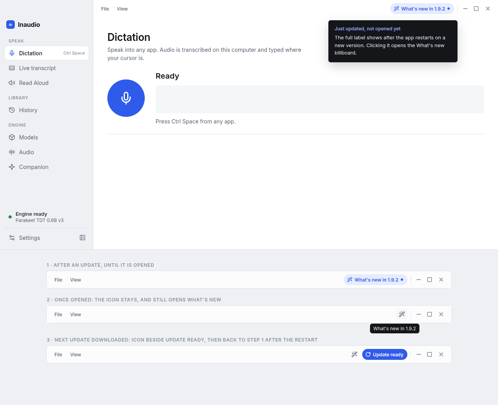

The sidebar no longer has a What's new card. A `WhatsNewButton` sits in the title bar, left of the update indicator and the window controls, and has two states:

| State | When | What it shows |
| --- | --- | --- |
| New | The running version is not `announcements.seenVersion` | "What's new in x.y.z" with a dot, on the accent's soft background |
| Seen | The billboard was opened for this version | The wand icon only, with "What's new in x.y.z" as its tooltip and accessible name. Clicking it still opens the billboard |

No new setting was needed: `seenVersion` already records which version's notes were seen, and closing the billboard updates it. When an update installs and the app restarts on the new version, the versions differ again, so the full label returns until it is opened. The automatic billboard after an update, and its "Don't show after updates" switch, work as before.

The update indicator no longer draws its own divider. The title bar draws one divider before the window controls, so What's new and the update indicator sit together as a group.

| Light | Dark |
| --- | --- |
| 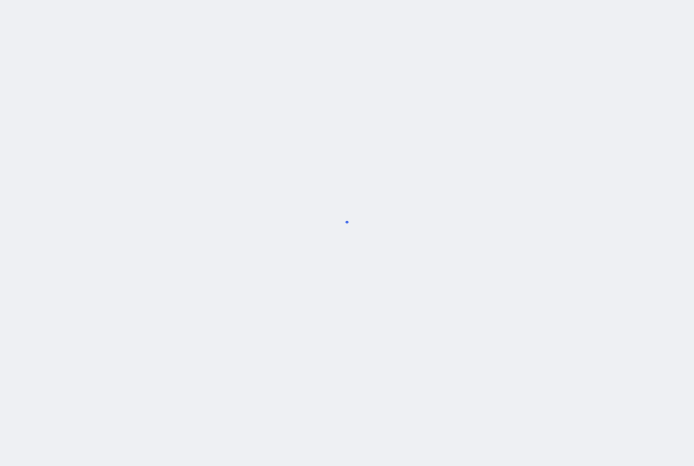 | 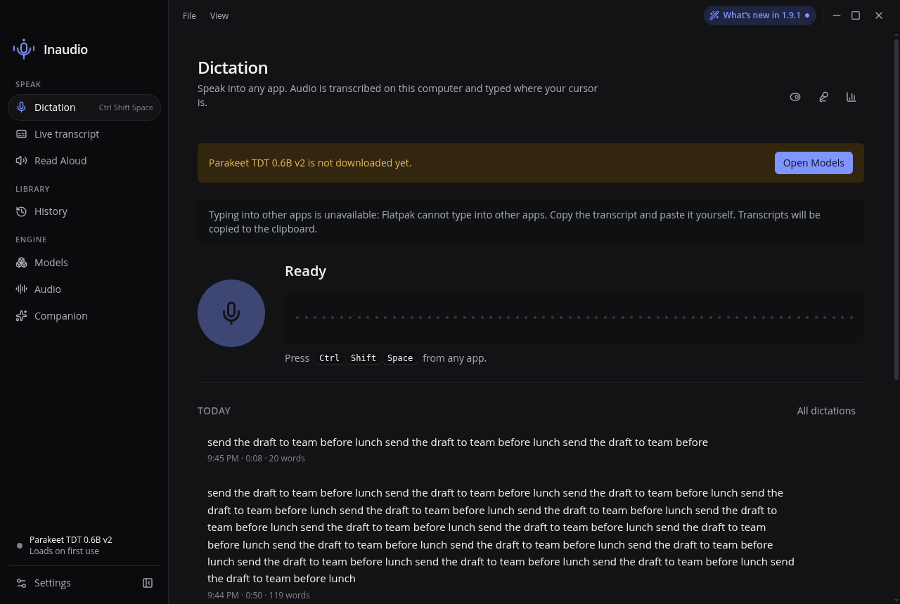 |

## 2. Activity opens in a drawer, split by model

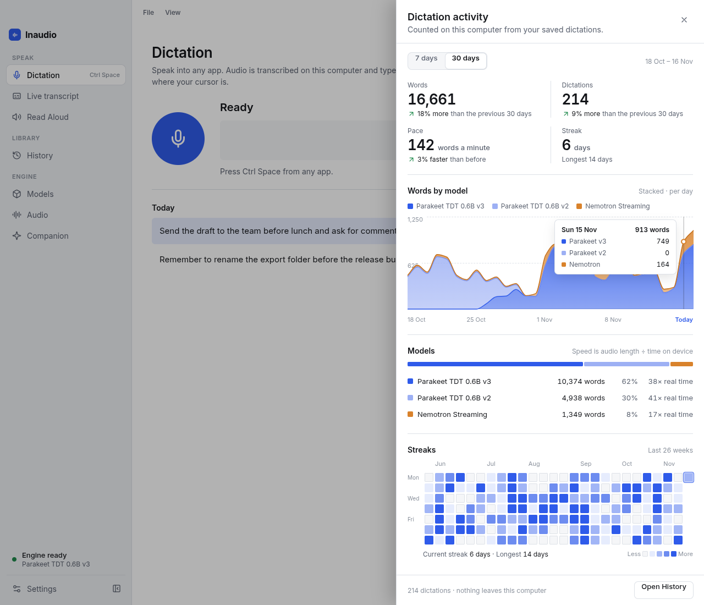

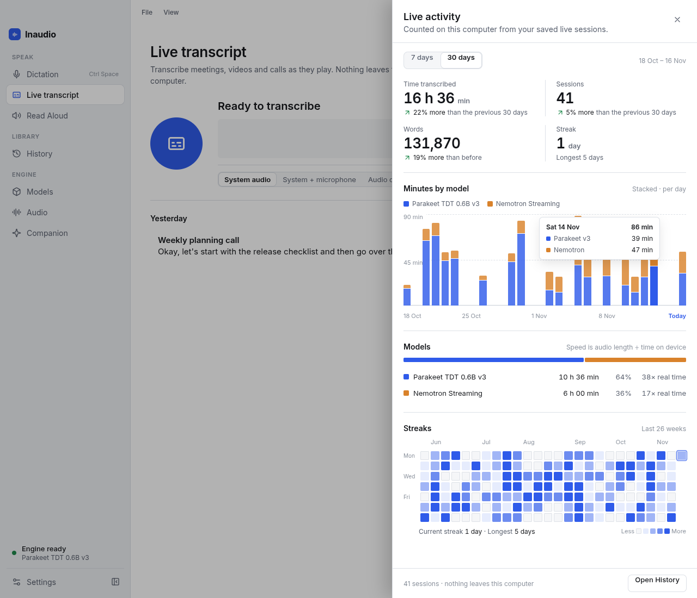

The Activity section used to sit on the Dictation and Live pages, between the recorder and the recent takes. It now opens in a side drawer (`ActivityDrawer`, in `components/ui/activity-drawer.tsx`). The pages stay focused on recording, and the drawer has the width for charts. The drawer queries `history:stats` only while it is open.

Inside the drawer:

- **A range switch** for 7 or 30 days, plus the dates it covers.
- **Four figures**, in a 2 × 2 grid, each with its change from the period before. Dictation: words, dictations, pace and streak. Live: words, sessions, time transcribed and streak.
- **The chart, split by model:**
  - Dictation: a stacked area of words per day. It uses a monotone curve, which never overshoots a day's real value.
  - Live: stacked columns of minutes per day. Sessions come in bursts, and columns read better than a curve with gaps.
  - Hovering, or using the arrow keys on the focused chart, shows a card with the day and each model's share. A screen-reader table carries the same numbers.
- **Models table:**
  - Each model's words (Dictation) or audio time (Live), and its share.
  - Its speed on this computer: length of audio ÷ time spent transcribing, written as "38× real time".
- **Streaks:** see [Streaks fill the drawer](#streaks-fill-the-drawer).

| Dictation, light | Live, dark |
| --- | --- |
| 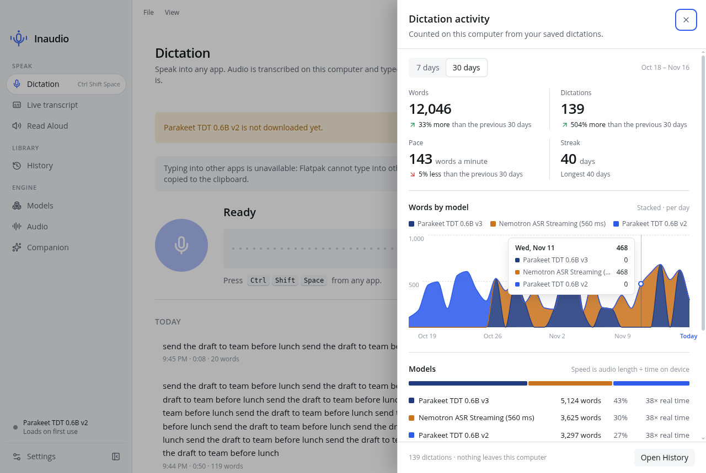 | 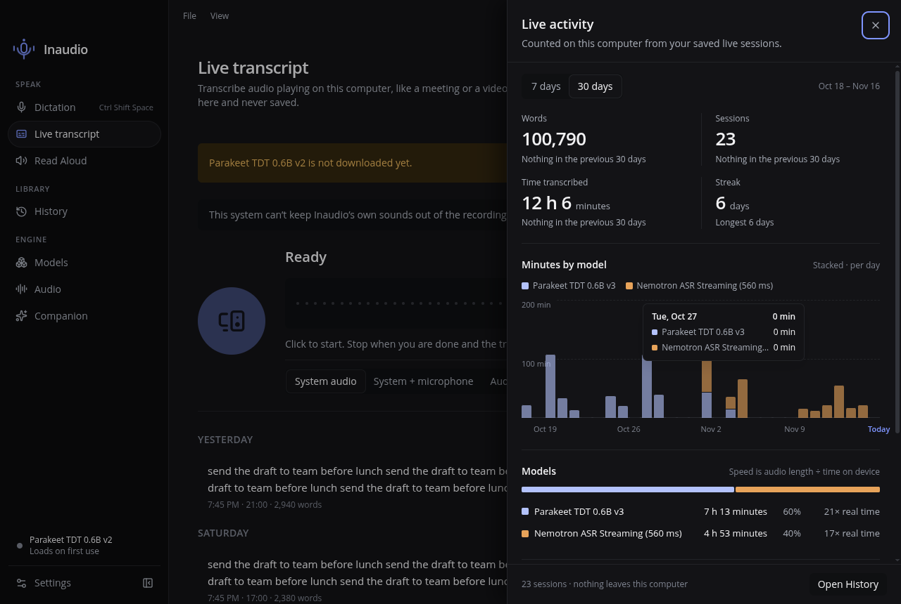 |

### How the numbers are counted

The renderer still never reads transcripts to count them. `HistoryRepository.activity()` now also selects `model_id` and `inference_ms`. `activityOf()` in `src/shared/history/stats.ts` adds a `models` list for the range: words, takes, audio, time on device, and per-day words and audio for each model. The list is ordered by words. A row without a model counts as `unknown`; a model no longer in the catalog shows as "Removed model". Two new cases in `scripts/history-stats.test.mjs` cover the split and the unknown model.

### Colours

Series colours are tokens, `--chart-1` to `--chart-4`, assigned by the model's place in the catalog. A model keeps its colour whichever is used most.

- `--chart-1` is the accent.
- `--chart-2` mixes the accent toward the text colour. It is darker in light mode and lighter in dark mode, so the two always differ in lightness and not only in hue.
- `--chart-3` is orange, or teal under the amber accent tone.
- `--chart-4` is for unknown models.

The fills are flat; the app uses no gradients.

### Streaks fill the drawer

The heatmap was a fixed 12 × 7 grid of 12 px cells, about a third of the drawer's width. It now shows 26 weeks (`ACTIVITY_WEEKS`) in fluid columns of square cells across the full width, with month labels on top and Mon, Wed and Fri down the side. Today is outlined. Under the grid: "Current streak N days · Longest M days" and the Less → More key. Stretching 12 weeks to that width would have made the cells about 40 px each, so the range grew instead.

| Light | Dark |
| --- | --- |
| 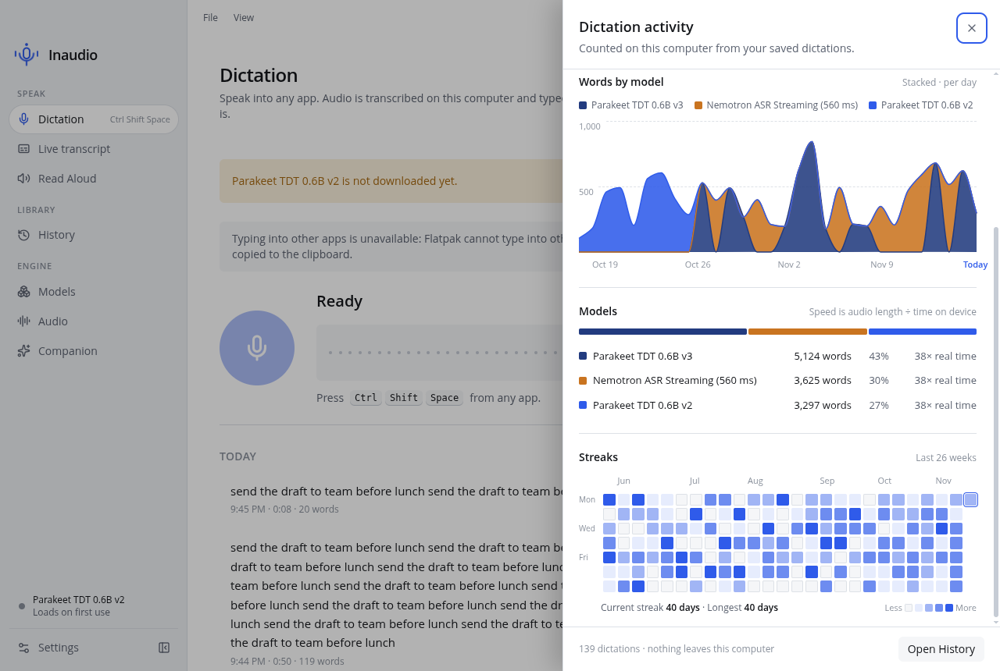 | 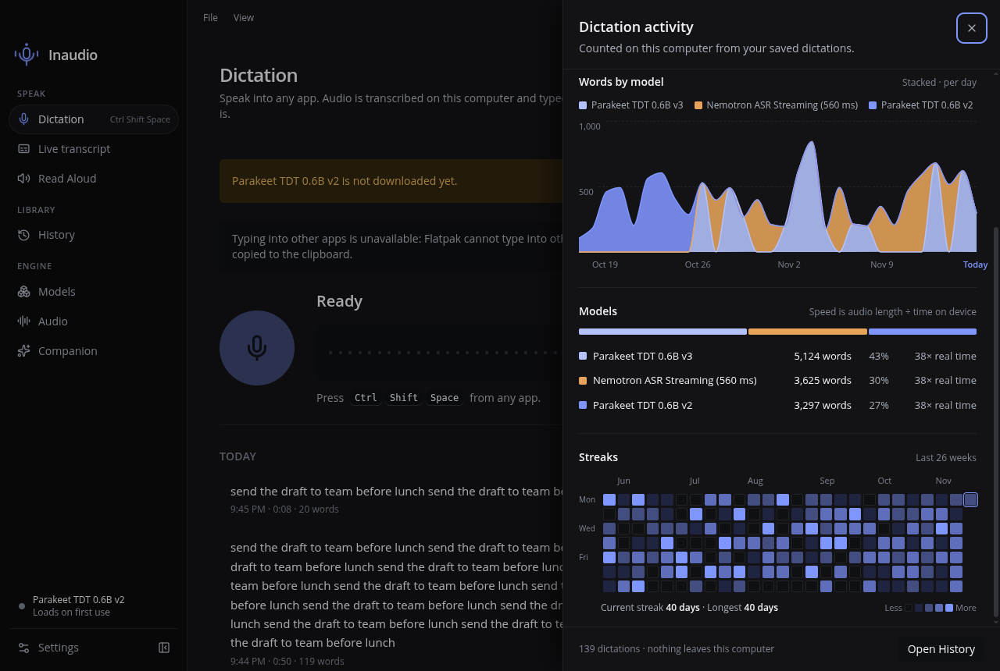 |

## 3. Icon actions in the Dictation and Live headers

The page headers now use icon buttons with tooltips, not labelled buttons and badges:

| Page | Icons |
| --- | --- |
| Dictation | Mode (toggle or hand), opens Settings › Dictation · Microphone, opens Audio · Activity |
| Live transcript | Saved sessions · Activity · Pop out |

Each icon's tooltip and accessible name carry what the label used to say: for example "Toggle. Change in Settings", or the microphone's name.

| Dictation | Live transcript |
| --- | --- |
|  | 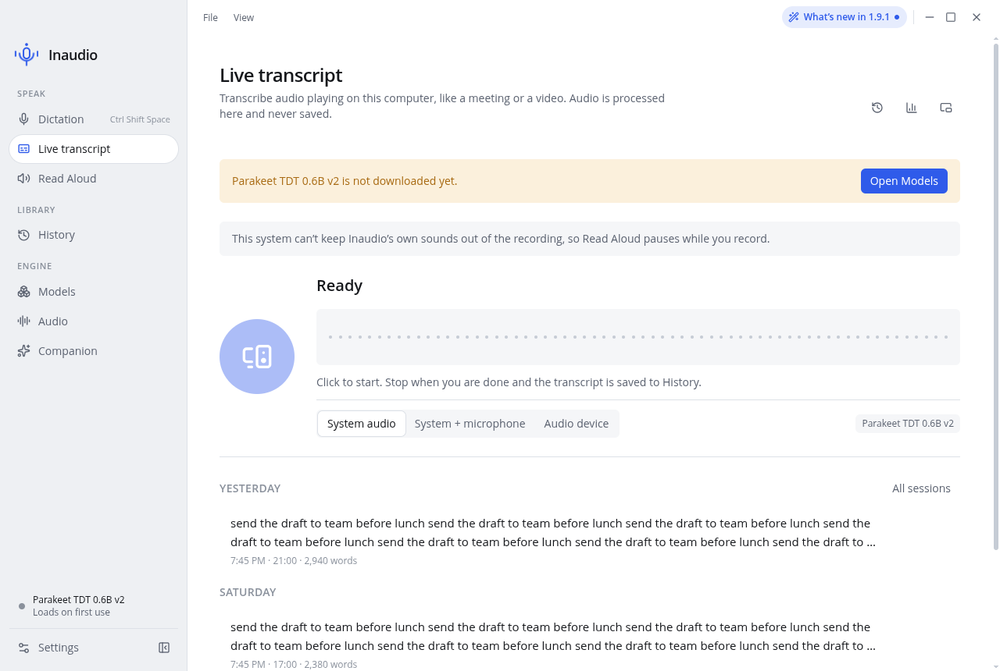 |

## 4. The companion can be dragged

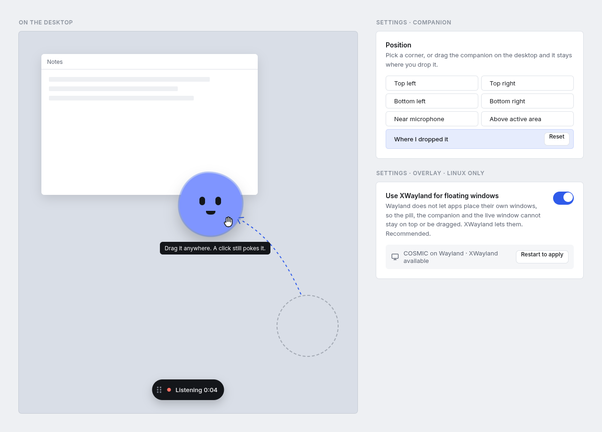

The companion can be dragged anywhere, the same way the recording overlay can.

- **Renderer** (`useCompanionDrag` in `src/renderer/companion.tsx`):
  - A press that moves more than 4 px is a drag; a press that stays put is still a click.
  - During a drag, pointer positions in screen coordinates go to main over `companion:drag`, at most once a frame.
  - A grab cursor shows where moving is possible.
- **Main** (`CompanionService.dragTo()`):
  - The window follows the pointer and stays inside the screen's work area.
  - Click-through stays off for the whole drag.
  - On release, the window's centre is saved as shares of that work area (`companion.customX` and `companion.customY`), never in pixels, the same way the overlay does it.
  - `placeCompanion()` puts a dropped companion back at that spot, and "Above active area" tracking pauses while a spot is set.
- **Settings › Companion:**
  - "Where I dropped it" appears in Desktop position, with a Reset button.
  - Picking any other position clears the spot.

The schema adds `customX` and `customY` as nullable numbers. An older settings file has neither, and both fall back to `null`.

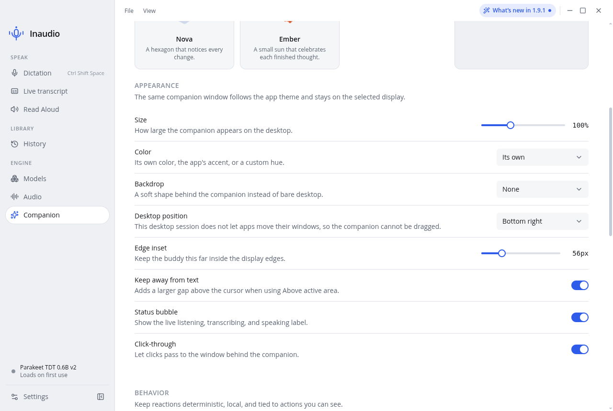

## 5. Floating windows on Linux Wayland

### What was wrong

On Pop!_OS 24.04 the desktop is COSMIC on a Wayland session, and Electron 44 runs there as a native Wayland client. Three Wayland rules follow from that:

- A client cannot place its own windows. `setBounds()` positions are ignored, so the overlay, the companion and the live window cannot sit where they are put, and cannot be dragged.
- Stay-on-top is ignored.
- `showInactive()` is not reliable, so the app called `show()`. That focuses the floating window. COSMIC then draws its focused-window outline around the whole transparent window, padding included. That is most likely the extra frame seen around the pill. No screenshot of that frame has been captured yet; see [what was not verified](#not-verified-yet).

Two other causes were tested and ruled out:

- **GTK shadows:** Electron 41+ gives frameless windows GTK drop shadows and wider resize edges on Wayland by default. A probe window on this COSMIC session with `hasShadow: false`, which all three floating windows already set, received its full content size, with no frame added.
- **Switching inside the app:** `app.commandLine.appendSwitch('ozone-platform', 'x11')` in the main process does not move the app to X11; Chromium has picked its display backend before any app code runs. The same flag given at launch does switch it.

### What changed

- **Relaunch under XWayland** (`relaunchUnderXWayland()` in `src/main/app/platform.ts`). It runs right after the single-instance lock, before any window opens, and only when all of these hold:
  - the build is packaged;
  - the session is Wayland;
  - XWayland is running, meaning `DISPLAY` is set;
  - the new setting is on;
  - the process has not already been relaunched once.

  The app then starts again with `--ozone-platform=x11` and exits, handing over the lock. An environment mark prevents a loop, and an AppImage relaunches through `$APPIMAGE`.
- **`isWayland()`** now means "this process is a native Wayland client". It is false under XWayland, so the overlay goes back to `showInactive()`, stay-on-top and placement there.
- **Hiding the drag controls:** `OverlaySupport.place` is false on native Wayland. In that case the pill hides its drag handle and the companion cannot be picked up.
- **New setting:** Settings › Overlay › "Use XWayland for floating windows" (`system.linuxXWayland`, on by default). It appears only on Linux Wayland sessions, with a line saying how the app is running right now. A change offers "Restart to apply". It goes through the new `file.restart` command, which works out the launch flag from the setting again. In a development build that command explains to type `rs` instead, because the Vite dev server stops with the process.
- **Status:** `SystemStatus.linuxDisplay` reports the session, whether the app runs through XWayland, whether XWayland is available, and the desktop name. It reads environment variables only, so status paths still do not touch the disk.

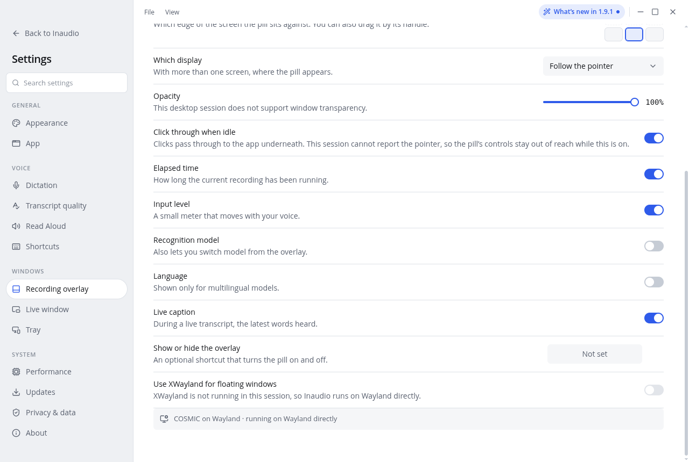

## 6. `npm start` inside a Flatpak

`npm start` used to abort when run from the Flathub build of VS Code with:

```text
The SUID sandbox helper binary was found, but is not configured correctly.
```

Flatpak blocks nested user namespaces and setuid, so Chromium cannot sandbox itself there, and making `chrome-sandbox` root-owned does not help inside the sandbox. `npm start` now runs `scripts/start.mjs`, which wraps `electron-forge start` and passes any arguments through. On Linux it adds two flags, for that development run only:

- `--no-sandbox` inside a Flatpak.
- `--ozone-platform=x11` on a Wayland session with XWayland running, unless the XWayland setting is off. A packaged build relaunches itself for this; under Forge's dev server it cannot.

Packaged builds are not affected. Outside a Flatpak, the `chrome-sandbox` error is still fixed with `sudo chown root:root` and `chmod 4755` on `node_modules/electron/dist/chrome-sandbox`. `AGENTS.md` notes this.

## Verification

- `npx tsc --noEmit -p tsconfig.json` and `npx eslint --ext .ts,.tsx src` pass.
- `node --test scripts/*.test.mjs`: 90 tests pass, including the two new per-model cases.
- The Dictation and Live drawers, the title bar, the header icons, Settings › Overlay and Settings › Companion were driven through the DevTools protocol in a development build, in light and dark themes, with no renderer exceptions. Those runs produced the screenshots above.

### Not verified yet

- Relaunching under XWayland, and dragging the companion and the pill, on a desktop where XWayland is available. The development environment had no X display.
- Whether the frame around the overlay on COSMIC is gone under XWayland.
- An installed or packaged build on Windows and macOS. The changes there are the title bar, the drawer, the header icons and companion dragging, which do not depend on the platform code above.
